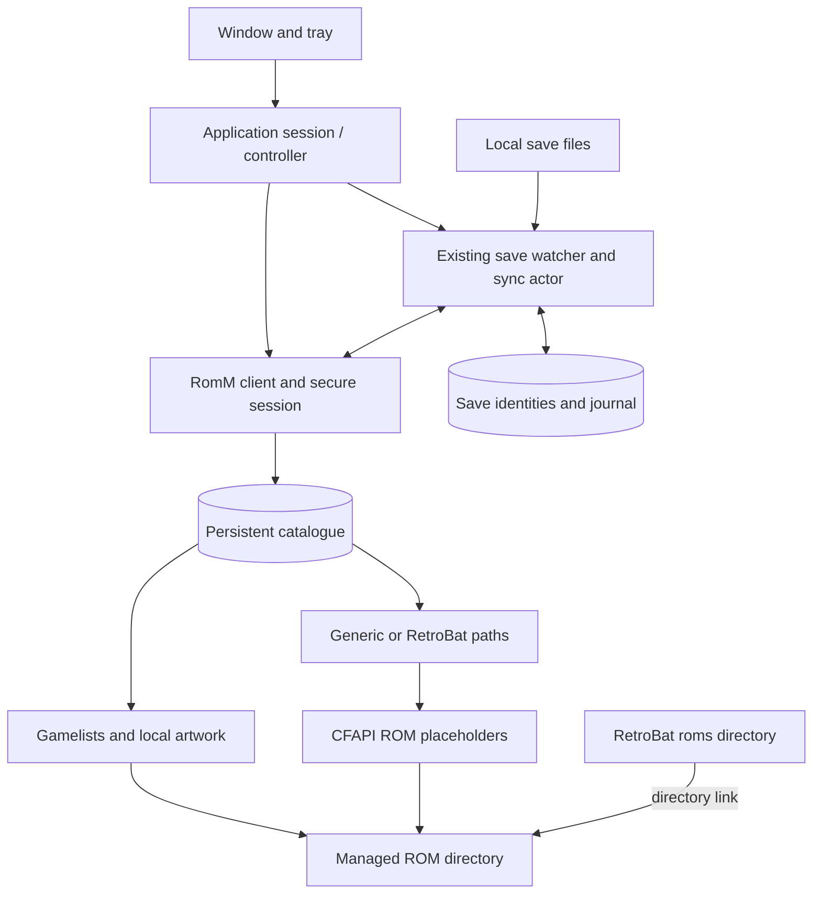

# Plan: address the RomMFS findings

Date: 2026-10-07  
Status: implementation and applicable Linux checks complete; Windows/human validation deferred
Input: [NOTES.md](NOTES.md), including the original findings, production logs, and agreed decisions.

### Implementation tracking (2026-10-08)

- [x] Source-backed pairing, metadata, file, installer and save-path contracts.
- [x] Diagnostic progress, rotating logs, failure/retry and cancellation states.
- [x] Remembered sessions, account isolation, application-owned workers and deliberate Quit.
- [x] Persistent catalogue, warm reuse, explicit refresh, Generic/RetroBat layouts.
- [x] Official digest-verified installer workflow, safe linking, settings and frontend metadata.
- [x] Ordinary-file save identities, streams, clean-client reconstruction, consent/journal migration and baseline/conflict handling.
- [x] Switch updates/DLC and supported BIOS/keys/unpacked firmware/RetroArch cheats, with explicit unsupported-format diagnostics.
- [x] Focused desktop views, packaged/tray icon, single instance and optional ordered login startup.
- [x] Final full-scope verification/review and reconciled evidence ledger: 242 portable passes, warning-denied Linux/Windows UI checks, dependency/secret scans, formatting and local documentation links.

Detailed evidence and compatibility limits: [implementation status](../../docs/validation/2026-10-12.md).
The Windows/human checks in section 5 remain unchecked; implemented does not mean runtime-validated.

## 1. Target outcome

Provide a reliable Windows application that remembers its connection, mounts quickly with useful progress and logs, and supports **generic folders and RetroBat**. Automate RetroBat setup and metadata, and synchronize saves as ordinary files without parsing emulator formats.

The RetroBat support statement will be:

> The RetroBat integration requires a fresh installation configured through RomMFS setup. Its ROM directory must be empty or already managed by RomMFS.

RetroBat 8.2.1 is a source/package reference, not an enforced version requirement or a claim of completed runtime testing. Accept other releases, including patch upgrades, when the required layout and settings are present. Version numbers are diagnostic information; never reject an installation solely because it differs from 8.2.1. Report a specific missing capability when it prevents an operation. RomM 5.3.1 is the existing API baseline in [RomM API contract](../../docs/contracts/romm-api.md).

Implementation is being done on Linux. Complete source research, implementation, and applicable automated Linux checks here. All real Windows execution and all human testing are deferred to section 5; they do not block implementation or require the user to run checks during this work. Keep those outcomes explicitly unverified.

### Scope decisions

- Offer two integration modes: **Generic folders** and **RetroBat**. ES-DE is research context, not another integration deliverable.
- Link RetroBat's `roms` directory to the RomMFS-managed ROM directory.
- Offer installation from the official RetroBat stable release and repeatable setup of a fresh installation, without an exact-version gate.
- Reject a ROM directory containing any files not owned by RomMFS. Show the conflicting paths; do not back up, move, import, or remove those files, including stock files supplied by RetroBat.
- Generate per-platform `gamelist.xml` and local artwork from RomM metadata. Preserve frontend favourites and play history.
- Safely configure Eden/Citron to save under RetroBat's saves directory using the supported configuration structure.
- Accept save files of every format, including companion files, extensionless files, and multiple files per game. Preserve their bytes and relative paths.
- Extend the existing recursive save watcher. Defer **shared saves and shared memory cards**.
- When enabled, Windows startup launches RomMFS in the tray, reconnects, mounts, and resumes previously enabled save sync.
- Cover Switch updates/DLC, cheats, and other library files through explicit API and destination checks followed by implementation for the supported contract.

The approved scope supersedes conflicting PoC restrictions in [PRD.md](PRD.md), including memory-only authentication, no tray/autostart, ROM-only metadata, and reload-on-every-mount. Keep one application, one configured server, and one mount; retain the existing Rust crates, GPUI Kit, CFAPI, and SQLite infrastructure.

## 2. Starting evidence

| Finding | Current implementation / evidence | Required change |
| --- | --- | --- |
| Slow connection/mount | Connect loads the catalogue; mount immediately loads it again. Logs show about 31 seconds for each catalogue fetch and roughly 1–2 seconds for native setup. | Remove the duplicate fetch, persist metadata, and time individual requests before further optimization. |
| Remount HTTP 500 | User reported recovery after restarting; the failing request was not captured. Cause remains unknown. | Capture request/stage context and exercise repeated stop/start and recovery. |
| Save restrictions | Existing recursive watcher; mapping and transfer logic assume GB/Gambatte, `.srm`, one path per ROM, and a 1 MiB limit. | Keep watcher/queue infrastructure; replace format assumptions with file identities and game associations. |
| Missing metadata | DTOs discard available descriptions/artwork; tree and native ownership rules assume ROM-only content. | Retain metadata and support writable generated files beside protected ROMs. |
| Crowded UI | Vertically stacked sections squeeze the log; completed downloads linger; mounting has only a status marker. | Separate views, maintain usable scrolling, and display actual operation progress. |

## 3. Architecture decisions

The following compact ADRs record the implementation direction and its costs. Source/configuration details are resolved in step 1; native and human verification is deferred.

| ADR | Context and decision | Alternative / consequence |
| --- | --- | --- |
| 01 — Application lifetime | The current window owns work that must survive hiding it. An application session owns the controller, mount, and sync workers; window and tray observe that session. | A separate service adds deployment overhead. Keep one process and make Quit perform explicit shutdown. |
| 02 — Catalogue snapshots | Persist the last complete catalogue using the existing SQLite approach, scoped to server and account. Mount a stable snapshot; refresh separately. | Live tree mutation adds native lifecycle complexity. Structural changes become visible on the next safe remount. |
| 03 — Local metadata | Generate gamelists locally from the projected paths and cached RomM metadata; cache artwork as ordinary local files. | Server-side export exists, but its paths need adaptation to the Windows projection. Local generation also permits merging frontend state. |
| 04 — Save files | Model game association separately from file contents. Reuse the watcher, journal, and queues with a stable identity for each relative save path. | Emulator format handlers unnecessarily restrict transfer. Location/mapping rules remain necessary to associate a file with the correct RomM game. |
| 05 — RetroBat setup | Support fresh installations through layout/settings checks, retain the normal directory layout, and link the ROM directory to the managed root. | Exact-version rejection would obstruct compatible upgrades. Refuse unowned ROM-directory files and retain a setup record; do not add ROM-folder migration or backups. |
| 06 — Mixed mount contents | Keep ROM placeholders protected while allowing ordinary gamelists/artwork and frontend state to persist. Extend ownership and cleanup rules accordingly. | A blanket read-only root cannot support frontend writes. Implement from Windows API/source contracts here; track actual ACL and cleanup behavior as deferred Windows evidence. |



ROM byte cache, catalogue cache, artwork, and save snapshots have separate lifecycles. ROM inactivity eviction must never remove saves or frontend state. Listing, metadata generation, and artwork retrieval must not hydrate ROMs.

## 4. Implementation sequence

### Step 1 — Close the specific contract gaps

**Primary files:** `docs/contracts/romm-api.md`, `.planning/PRD.md`; release investigation feeds the following steps.

- Inspect the official installer/source for installation arguments, directory layout, and launcher/frontend configuration. Record the release examined for reproducibility and available integrity/signature evidence. Make compatibility depend on required files/settings rather than exact version equality; installer execution is deferred.
- Verify Eden and Citron's save-location setting from source/configuration samples: config file, serialized key/value, override precedence, and resulting directory. Current launcher source uses `yuzu_mutualize`; do not assume the final serialized key from that name alone. Emulator runtime confirmation is deferred.
- Verify RomM 5.3.1 browser pairing, token lifetime/renewal, account identity, metadata/artwork access, and required scopes. Extend the existing small client contract instead of generating an entire API client.
- Confirm how RomM exposes platform/path mappings, file paths/categories, individual file downloads, and save associations such as title IDs or save targets.
- Prove how multiple save files and nested relative paths round-trip through the supported save API. Record stable remote identity and original-path representation, including any server filename rewriting. A second clean client must be able to reconstruct the files; a local journal alone is insufficient.
- Produce a short file-category table for ROMs, Switch updates/DLC, cheats, BIOS, artwork, and other relevant entries: API source, content route, destination, and whether the frontend should list them as games. Record actual API limitations instead of inventing routes.
- Update obsolete PRD restrictions to the approved scope. Retain lazy ROM hydration, explicit error reporting, and protection of unrelated local files.

**Implementation complete when:** each dependent feature has a source-backed contract and a sample suitable for automated fixtures. Any missing server capability is recorded as a specific compatibility requirement or implementation dependency. Windows execution and human sign-in checks remain deferred.

### Step 2 — Make mounting diagnosable and recoverable

**Primary files:** `rommfs-app/src/controller.rs`, `window.rs`; `rommfs-core/src/events.rs`, `romm/client.rs`; `rommfs-cfapi/src/imp.rs`.

- Add operation stages for authentication, cache loading, catalogue pages, projection, root preparation, placeholder creation, and stopping. Show elapsed time and real counts; use indeterminate progress when no total exists.
- Write bounded rotating diagnostic logs to the application data directory. Include controller events and native/backend errors, with an Open log folder action.
- Record operation IDs, request route, status, elapsed time, pagination position, relevant ROM/file IDs, and error chains. Exclude credentials, tokens, cookies, authorization headers, and sensitive authentication query values.
- Make cancellation and failure leave explicit states. Drain native callbacks and transfers on stop; allow retry without restarting the process. Prevent stale worker events from changing a newer session's state.
- Investigate the reported HTTP 500 using these diagnostics. Distinguish authentication rejection, permission failure, transport failure, and server failure; do not automatically blame token expiry or repeatedly retry every 500.

**Implementation complete when:** progress/error events reach the UI and durable logs, and portable controller/HTTP checks cover failure and retry. Actual Windows mount/remount behavior and visual review remain deferred.

### Step 3 — Remember the connection and own background work correctly

**Primary files:** `rommfs-core/src/romm/client.rs`, `romm/types.rs`; `rommfs-app/src/controller.rs`, `main.rs`, `window.rs`; focused settings/platform modules as needed.

- Implement the verified RomM pairing flow using the system browser and show pairing progress, cancellation, rejection, and expiration states.
- Persist the resulting secret in Windows Credential Manager. Store ordinary preferences separately: server, account reference, mode, paths, startup preference, and previously enabled sync scope. Do not persist the user's password.
- Renew expiring tokens where the verified flow supports it; otherwise show a clear sign-in requirement. Serialize renewal so concurrent work does not race to refresh the session.
- On logout/account/server change, cancel the old session and invalidate its active mount/sync scope. Keep cache and journal ownership tied to the appropriate account and installation.
- Move controller lifetime into the application session so closing/hiding a view does not accidentally destroy the mount. Keep a single running instance and a deliberate Quit path.

**Implementation complete when:** session restoration, renewal/rejection, and lifecycle transitions are implemented and covered by Linux-compatible checks. Real browser approval, Windows Credential Manager behavior, and window/tray interaction remain deferred.

### Step 4 — Cache the catalogue and implement the two layouts

**Primary files:** `rommfs-core/src/romm/types.rs`, `catalog.rs`, `tree.rs`, `cache/`; `rommfs-app/src/controller.rs`.

- Persist the complete successful catalogue, descriptive metadata, source identities, and refresh timestamp atomically. Use a versioned schema; scope source data by server/account and derived paths by integration mode/mapping version.
- Reuse the catalogue already loaded by Connect. StartMount must not repeat the same catalogue request sequence.
- Set this refresh policy: authenticate first; use a valid cached snapshot for a warm mount; perform one background refresh per connected application session; also provide explicit Refresh. With no cache, the initial successful fetch serves as that session's refresh. Remount alone does not force a fetch.
- Keep the current tree stable while mounted. Stage structural changes for the next safe remount and show that a refresh is pending. Metadata-only changes can be published when RetroBat is closed. Do not add a periodic polling service in this iteration.
- Retain the last complete snapshot when a refresh/page fails. Show its age and the refresh error; never convert failure into a successful empty library. Authentication failure must not be hidden by the cache.
- Generic mode uses the verified RomM platform/path mapping. RetroBat mode maps platforms to the frontend's supported folder configuration. Validate relative paths, preserve file extensions, and resolve Windows-invalid names and case collisions deterministically.
- Carry individual file identity and relative paths through projection, cache lookup, and download events. Replace ROM-ID-only download row keys where multiple files could collide.
- Report zero file records, missing files, unsupported game layouts, and auxiliary media distinctly. Summarize recurring catalogue warnings and retain details without duplicating the same messages on Connect and Mount.
- Measure portable catalogue/projection work against a fixture with the observed 25-platform, 2,448-ROM library shape. Use request counts and timings to guide further optimization. Defer actual Windows mount timing and make no unmeasured total-latency promise.

**Implementation complete when:** Linux-compatible client/controller fixtures demonstrate one fetch per catalogue page, warm snapshot reuse, refresh failure preservation, and both projected layouts without ROM-body requests. Native mount performance remains deferred.

### Step 5 — Automate fresh RetroBat installation and metadata

**Primary files:** new focused setup/metadata modules in the existing crates; `rommfs-core/src/catalog.rs`, `tree.rs`; `rommfs-cfapi/src/security.rs`, `root.rs`, `imp.rs`; app settings/controller integration.

#### Installation and linking

- Offer installation using an official stable package or selection of a fresh installation. Record the installed version for diagnostics, accept compatible upgrades, and handle installer failure/cancellation. Do not show an error or warning solely because the version differs from the research baseline.
- Retain RetroBat's normal `bios`, `cheats`, `emulationstation`, `saves`, `screenshots`, and `sounds` directories. Link `<RetroBat>/roms` to the RomMFS-managed root.
- Before changing the ROM directory, reject any files not identified as RomMFS-owned and list the conflicting paths. This also applies to stock helper/media files in a fresh RetroBat installation. Leave the directory untouched and explain that it must be emptied by the user before setup can proceed. Empty subdirectories are allowed; verify an existing directory link's target and ownership before reusing it.
- Record setup-owned changes so rerunning setup is idempotent and partial setup can be recovered. Resolve the link to the actual managed root for CFAPI ownership checks.
- With RetroBat stopped, back up the affected configuration file and make the targeted Eden/Citron setting change confirmed in step 1. This config backup does not extend to the ROM directory. Preserve unrelated configuration and resolve the effective save destination from settings. Detect overrides that would undo it; runtime confirmation is deferred.
- Explain a missing emulator separately from a missing save setting; do not assume the RetroBat installer includes Eden/Citron.

#### Writable metadata and ownership

- Implement ordinary writable `gamelist.xml` and artwork beside protected ROM placeholders using the documented Windows API contracts. Replace blanket directory permissions only as needed, retaining protection against ROM overwrite, rename, and deletion. Native execution is deferred and is not an implementation prerequisite.
- Account for parent `FILE_DELETE_CHILD` behavior in the ACL design. Record actual delete/rename/write checks in the deferred Windows list; portable checks cannot prove native protection.
- Extend ownership records to distinguish ROM placeholders, generated metadata/artwork, and frontend state. Recognize these files on remount and preserve favourites/history through stop, crash recovery, and cleanup. Keep refusing unrelated unowned content.

#### Generation and refresh

- Retain and map available RomM title, summary, genres, developer/publisher, release date, players, rating, cover, and screenshot fields to the supported frontend gamelist schema.
- Generate `<path>` and media references from actual projected filenames, including sanitization and collision resolution. Escape XML correctly; do not derive launch paths from display titles.
- Download available artwork with bounded concurrency into a persistent local cache. Publish local files/references; missing artwork is a visible nonfatal issue. Avoid a per-ROM detail request when the paginated catalogue already supplies the fields.
- Merge generated descriptive fields with existing frontend-owned favourites, play counts, and history using stable game identities. Handle path changes without losing that state.
- Atomically publish complete gamelists while RetroBat is stopped. Queue refresh publication while it runs to avoid its in-memory state overwriting newer XML on exit.

**Implementation complete when:** portable setup checks cover unowned-file rejection and repeatability; configuration and XML fixtures preserve unrelated settings and frontend state; metadata requests do not request ROM bodies. Real installation, directory links, RetroBat discovery, and ACL behavior remain deferred.

### Step 6 — Generalize save synchronization

**Primary files:** `rommfs-core/src/save_sync/{profile,mapping,path,journal,scheduler}.rs`, `romm/saves.rs`; `rommfs-app/src/save_sync_agent/{actor,transfer,incoming_transfer,files}.rs` and related journal modules.

- Replace the GB/Gambatte profile requirement with generic save roots and RetroBat path resolution. Remove exact RetroBat version rejection from the existing profile code. Separate locating a game's saves from understanding their contents.
- Remove extension and emulator whitelists, `.rtc` rejection, `.srm` assumptions, and the arbitrary 1 MiB ceiling. Treat zero-length files according to the actual file/API contract, not SRAM rules; stream large snapshots with explicit server/disk-limit errors.
- Give each file a stable identity scoped to server, account, installation, game, and normalized relative path. Group companion/nested files by game. Migrate existing mappings, baselines, queued work, and journal records without silently enabling new sync scopes.
- Implement the remote path/identity representation verified in step 1. Preserve original relative paths even when the server rewrites uploaded filenames; avoid basename collisions and per-client-only reconstruction rules.
- Associate saves through verified game/title identifiers and path conventions. Surface unmatched files for mapping instead of guessing or dropping them. Shared saves/cards remain explicitly unsupported in this release.
- Reuse the existing recursive `notify` watcher, queue, fallback scans, and retry handling. Reconcile at startup, after reconnect, and after watcher overflow; wait for writes to settle and snapshot consistent files before uploading.
- Watch save data only. An emulator's portable directory may also contain firmware, caches, and settings; these are not all saves merely because they are under a common parent.
- Upload changed snapshots and download remote changes. Compare local and remote content with the last synchronized baseline: apply one-sided changes only when the destination remains unchanged; preserve both versions and request conflict resolution when both changed.
- Recheck before atomic replacement, coordinate with running emulators/file activity, and suppress watcher feedback from incoming writes. Defer application when safe replacement cannot be established.
- Keep pending work and snapshots across interruption. Local deletion does not automatically delete remote saves or trigger immediate restoration of a deliberately deleted file; retain an explicit journal state.

**Implementation complete when:** Linux-compatible fixtures demonstrate byte-identical two-client transfers for nested paths, companions, extensionless files, and files above 1 MiB, with interruption/conflict/restart handling. Actual Eden/Citron save placement and Windows watcher/file-lock behavior remain deferred.

### Step 7 — Include updates, DLC, cheats, and other files

**Primary files:** `rommfs-core/src/romm/{types,client}.rs`, `catalog.rs`, `tree.rs`, `download.rs`; RetroBat setup/materialization code from step 5.

- Implement the category/destination table established in step 1. Keep launchable games distinct from updates, DLC, cheats, BIOS, and artwork.
- Support individual original file downloads and safe nested paths where the verified API provides them. Extend beyond the current one-file-per-ROM assumption only with explicit file identities and correct download semantics.
- Expose Switch update/DLC `.nsp` files under `roms/switchupdates`. Current RetroBat source configures this as Eden's external-content directory; Eden supports using updates/DLC from external files without installation to NAND. Keep these entries out of launchable-game metadata. Native loading is deferred. [RetroBat launcher source](https://github.com/RetroBat-Official/emulatorlauncher/blob/master/emulatorLauncher/Generators/Eden.Generator.cs), [Eden release notes](https://git.eden-emu.dev/eden-emu/eden/releases).
- Materialize files needed outside the ROM tree, such as cheats or BIOS, at their verified locations using ownership/version records. Do not overwrite emulator-modified files blindly or include those files in save sync.
- Report unsupported server categories or genuinely unsupported layouts with an actionable reason. Do not expose a server-generated ZIP as if it were an original game file or silently discard the requested category.

**Implementation complete when:** source-backed category/destination rules and Linux fixtures place each supported file correctly and omit auxiliary files from launchable-game metadata. Actual frontend/emulator consumption remains deferred.

#### Eden content layout confirmed from documentation/source

Paths below are relative to the RetroBat installation. The `roms` directory links to the RomMFS-managed root, so its `switch` and `switchupdates` directories live in that root.

```text
RetroBat/
  roms/ -> <RomMFS-managed root>/
    switch/
      Game.nsp
    switchupdates/
      Game-update.nsp
      Game-dlc.nsp
  emulators/eden/user/
    keys/prod.keys
    nand/system/Contents/registered/
      <firmware files>.nca
    config/qt-config.ini
```

RetroBat configures the external update/DLC directory when launching Eden. Use a flat directory initially; nested-directory scanning has not been established here. This setup loads the external packages directly and does not require RomMFS to automate Eden's NAND installer. [RetroBat launcher source](https://github.com/RetroBat-Official/emulatorlauncher/blob/master/emulatorLauncher/Generators/Eden.Generator.cs), [Eden release notes](https://git.eden-emu.dev/eden-emu/eden/releases).

Switch BIOS content consists of firmware and keys in this integration. RetroBat documents placing `prod.keys` and unpacked firmware `.nca` files in the destinations above; its Eden launcher does not implement an automatic firmware/key install from `bios/switch`. RomMFS should materialize available user-library content at those destinations through the verified API. Do not assume dropping a firmware archive into `bios` installs it. Firmware archive handling depends on the actual library representation and remains a contract task. [RetroBat Switch documentation](https://wiki.retrobat.org/systems-and-emulators/supported-game-systems/game-consoles/nintendo-game-consoles/switch).

### Step 8 — Finish the desktop workflow and release documentation

**Primary files:** `rommfs-app/src/window.rs`, `controller.rs`, `main.rs`, Windows packaging/resources; `README.md`, `docs/testing/windows.md`.

- Use focused views for **Library/Mount**, **Save sync**, **Activity**, and **Settings**. Keep connection/mount status visible and all content reachable at supported window sizes. Give logs a usable independent scrolling area.
- Show actual mounting stages from step 2, counts/timings, last catalogue refresh, staged changes, and actionable failures.
- Rewrite save-sync copy in terms of the chosen folder, automatic upload/download behavior, pending files, unmatched files, and conflicts. Keep internal profile/journal terminology out of the normal flow.
- Separate active transfers from completed history; allow collapse and Clear completed. Retain failed entries for inspection and avoid pruning active transfers to satisfy a history cap.
- Add a packaged Windows application/taskbar icon and tray icon with Open, status, and Quit actions. Hiding the window leaves background work alive; explicit Quit shuts it down cleanly.
- Add the optional start-at-login setting. Run startup in order: restore secure session, reconnect, load cached catalogue/mount, then resume save sync only for the previously enabled and still-valid scope. A startup error remains accessible from the tray.
- Update public documentation with the support statement, two modes, cache/refresh behavior, save format policy and shared-save limitation, setup/recovery workflow, and diagnostic-log location.

**Implementation complete when:** views, history controls, icons, tray lifecycle, and autostart sequencing are implemented, with applicable automated state checks on Linux. Visual review, browser interaction, actual taskbar/tray behavior, and Windows login are deferred.

## 5. Automated checks and deferred validation

Writing this plan does not run tests. During implementation, use applicable Linux automation and source inspection. Every check requiring a real Windows environment or a human is explicitly deferred and must not hold up the Linux implementation.

### Checks available on Linux

| Area | Evidence to collect during implementation |
| --- | --- |
| API and cache | Real client against the HTTP fixture: pairing/renewal shapes, page counts, warm-cache behavior, failed-page preservation, account separation, per-file downloads, and zero ROM-body requests for listing/metadata. |
| Save sync | Byte-identical multi-file/nested round-trips between clean clients; companion and extensionless files; larger saves; stable-write snapshots; watcher recovery; conflict preservation; journal migration and restart. |
| Setup and metadata | Temporary-directory ownership/conflict checks, compatible-version acceptance, targeted config editing, XML merging, generated paths, and no ROM hydration during metadata generation. |
| Controller and performance | Automated state transitions, persistent logging, retry/expiry paths, cache/projection timings, and catalogue request counts for the observed library shape. |
| Windows code | Source review and cross-target type checks where the Linux toolchain supports them; these are not runtime evidence. |

### Deferred — requires Windows and/or a human

- [ ] CFAPI: mixed writable metadata/protected ROMs, parent-directory delete permissions, link resolution, remount ownership, hydration/eviction, and cleanup after interruption.
- [ ] RetroBat: actual installer execution, repeat setup, compatible upgrades, Eden/Citron output paths, gamelist loading, and favourites/history through frontend exit and refresh.
- [ ] Eden content: actual external update/DLC loading, firmware/key recognition, and the effect of scanning external content on lazy hydration.
- [ ] Windows saves: watcher notifications, active-emulator writes, file locking, and safe incoming replacement.
- [ ] Desktop: visual/interaction review, small-window scrolling, real browser approval, Credential Manager, taskbar/tray icons, hide/open/quit, and Windows login startup.
- [ ] Native reliability/performance: actual repeated mount/remount, the reported HTTP 500 reproduction if it recurs, and cold/warm Windows mount timings.

Document procedures in `docs/testing/windows.md` for later execution. Leave these checkboxes pending and report the implementation as awaiting native/manual validation. Do not ask the user to perform them as a prerequisite for continuing work on Linux.

## 6. Sources and remaining contract checks

- **Installer/reference:** [RetroBat official releases](https://github.com/RetroBat-Official/retrobat/releases). Record the package/source examined; 8.2.1 is the current research reference, with no runtime version lock.
- **Switch destinations:** [RetroBat Switch documentation](https://wiki.retrobat.org/systems-and-emulators/supported-game-systems/game-consoles/nintendo-game-consoles/switch) describes saves, firmware/keys, and the external update/DLC directory. Actual emulator behavior remains deferred.
- **Eden external content:** [Eden release notes](https://git.eden-emu.dev/eden-emu/eden/releases) document update/DLC loading without installation to NAND. Check required configuration support rather than enforcing a RetroBat version string.
- **Save setting and external paths:** [Eden generator](https://github.com/RetroBat-Official/emulatorlauncher/blob/master/emulatorLauncher/Generators/Eden.Generator.cs) and [launcher configuration loading](https://github.com/RetroBat-Official/emulatorlauncher/blob/master/emulatorLauncher/Program.cs) explain the current configuration. Confirm serialized setting names from source/samples; runtime and Citron-specific confirmation remain separately tracked.
- **Metadata and file fields:** [RomM schema at the repository's verified revision](https://github.com/rommapp/romm/blob/95599dadbe93c8f7b8a8647148fafbe293df3167/backend/endpoints/responses/rom.py) is the starting point for retaining metadata, file paths/categories, and save-target information.
- **Metadata alternatives and persistence:** [RomM export documentation](https://docs.romm.app/5.3.0-alpha/reference/exports/) describes server-side export; [RetroBat gamelist implementation](https://github.com/RetroBat-Official/emulationstation/blob/master/es-app/src/Gamelist.cpp) shows frontend reads/writes. Local generation is selected; Windows/human validation is deferred.
- **Authentication:** [RomM authentication documentation](https://docs.romm.app/5.0.0/developers/api-authentication/) provides pairing/token context. Record the actual 5.3.1 wire contract before implementation.

No further product choices are needed to begin. Resolve source/API contract questions during implementation and retain native/human checks in the deferred list.
