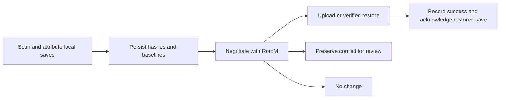

# RomMBat lessons for RomMFS

RomMBat's most useful contributions to RomMFS are its knowledge of actual
emulator save layouts, its EmulationStation lifecycle hooks, and its practice
of validating support per system, emulator, and core. RomMFS already has a
substantial synchronization foundation. Extend that foundation with better
discovery and lifecycle information; retain the filesystem architecture and
the existing ownership, consent, and publication safeguards.

Assessment date: **2026-10-16**. Three scouts inspected save synchronization,
RetroBat integration, and architecture/API/storage separately. Findings below
were checked against implementation and selected test source, with an
additional review of firmware placement. The upstream baseline is
[RomMBat commit 2bf8b15](https://github.com/Spinnich/rommbat/tree/2bf8b15fa98e57618728737e17e017d6ad71714f);
the RomMFS baseline is local commit
`4b95a6323baddfb668b9047b907d96568aca936d`. Existing working-tree documentation
and Windows test-wizard changes were left untouched. This was a source review:
neither application's tests nor a native RetroBat session were executed for it.
Upstream certification records are the project's reported evidence, not new
independent validation.

The architectural difference matters when choosing lessons. RomMBat downloads
selected games into a RetroBat installation and manages that local inventory.
RomMFS exposes original files through a catalogue snapshot and hydrates them on
read. A disk budget for a copied library, for example, does not directly map to
our cache or to the separate hydrated CFAPI files. See RomMBat's
[content planner](https://github.com/Spinnich/rommbat/blob/2bf8b15fa98e57618728737e17e017d6ad71714f/src/RomMBat.Core/Content/ContentPlanner.cs#L207-L280)
and our [architecture](../architecture.md).

RomMBat's ordinary-save synchronization runs as a flush. It drains local
events, correlates play sessions, scans state files before battery saves because
state sidecars can help identify them, and persists discovered identities and
hashes. This local work can run without a server connection. Sending comes
afterward through the shared
[SaveFlushService](https://github.com/Spinnich/rommbat/blob/2bf8b15fa98e57618728737e17e017d6ad71714f/src/RomMBat.Core/Sync/SaveFlushService.cs).

The negotiation request uses stable `(rom_id, slot)` identities, device identity,
content hashes, sizes, and actual file modification times. Local baseline
evidence can override an unsafe server decision: an unsent local save must not
be replaced simply because the server proposes a download. Offline changes
remain recorded for a later flush. See
[SaveSync](https://github.com/Spinnich/rommbat/blob/2bf8b15fa98e57618728737e17e017d6ad71714f/src/RomMBat.Core/Sync/SaveSync.cs#L395-L568).

Its client calls `/api/sync/negotiate`, treats an upload `409` as a conflict,
downloads without optimistically marking the device current, and acknowledges
only after a successful restore. These are useful protocol lessons, but
RomMFS's current inventory/revision-based journal already provides its own
reconciliation and upload verification. Adopting the server's negotiation API
would require a demonstrated benefit and migration design. Source:
[save API client](https://github.com/Spinnich/rommbat/blob/2bf8b15fa98e57618728737e17e017d6ad71714f/src/RomM.Client/Saves/RomMConnection.Saves.cs#L48-L218).

| Area | RomMBat approach | RomMFS today | Assessment |
| --- | --- | --- | --- |
| Ordinary save reconciliation | Local hashes/baselines, server negotiation, conflict records | Durable journal, snapshots, verified revisions, retries, conflict preservation | Preserve our foundation; borrow specific regression cases |
| Save discovery | Emulator-specific rules, game IDs, learned attribution, grouped units | Generic relative-file mapping, server save targets, explicit associations | Largest practical coverage opportunity |
| Memory cards | Emulator-specific save shapes and per-game attribution | Dedicated DuckStation and PCSX2 card synchronization | Existing local capability; keep its separate identity and consent |
| Save states | Installed RetroBat templates, emulator/core naming, separate state API | Can carry mapped state files as opaque saves; no semantic state API | Distinct optional feature with different conflict guarantees |
| RetroBat lifecycle | Native hooks and durable event spool | Resident app, filesystem observation, gamelist play-data reconciliation | Add lifecycle information to existing workers |
| Frontend metadata | Gamelists, media, menu registration, reload client | Gamelist merging, artwork, favourites/history, duplicate hiding | Menu entry is new; metadata basics already exist |
| BIOS placement | Accepted firmware hashes mapped to required destinations | Verified materialization, generally using server filenames | Improve destination selection |
| Interrupted ROM downloads | Persisted partials and conditional range requests | Private partial files, removed after failure | Investigate resumable original-file hydration |

The detailed evidence and proposed changes follow. Priorities describe expected
value and dependencies, not approved implementation commitments.

1. **Add measured emulator save rules at the existing mapping boundary. Highest priority; medium effort for a small first set.**

   RomMBat distinguishes individual saves, fixed sets of related files,
   game-specific units inside shared directories, and shared containers needing
   special treatment. Its rules describe the emulator, system, directory,
   filename convention, and ownership key. Separate attribution code handles
   cases where the filename contains a game ID or an emulator's title instead
   of the ROM filename. This is why a generic recursive scan alone cannot
   establish which game owns every save. Sources:
   [SaveScanner](https://github.com/Spinnich/rommbat/blob/2bf8b15fa98e57618728737e17e017d6ad71714f/src/RomMBat.Core/Content/SaveScanner.cs#L100-L122),
   [rules data](https://github.com/Spinnich/rommbat/blob/2bf8b15fa98e57618728737e17e017d6ad71714f/data/retrobat/save_rules.json),
   [game-ID attribution](https://github.com/Spinnich/rommbat/blob/2bf8b15fa98e57618728737e17e017d6ad71714f/src/RomMBat.Core/Content/GameIdAttributor.cs),
   [display-name attribution](https://github.com/Spinnich/rommbat/blob/2bf8b15fa98e57618728737e17e017d6ad71714f/src/RomMBat.Core/Content/DisplayNameAttributor.cs).

   Our active generic path already supports nested files, companion files,
   server-provided `save_target` layouts, and explicit user associations.
   Automatic conventional matching is narrower: it expects the system as the
   first path component and a game stem immediately beneath it. For example,
   `snes/libretro.snes9x/Game.state1` is not identified by that stem rule alone.
   The older GB profile is not the extent of our current save support. See
   [`SaveFileRules::associate_counted`](../../crates/rommfs-core/src/save_sync/ordinary_files.rs).

   Extend this mapping layer with a small set of independently verified rules,
   starting with common layouts inside already-consented save roots. Record
   which evidence produced each association; retain an actionable ambiguous or
   unsupported result when no unique owner exists. New paths under emulator
   folders require their own validated scope and consent. Do not let a
   discovered directory silently enlarge the user's approved roots.

   Proof should include two ROMs with the same stem, nested emulator/core
   directories, a renamed ROM, a misleading game ID, and unknown files left
   untouched. Each automatic rule also needs a real emulator save round trip.

2. **Use EmulationStation hooks to inform the existing save actor. High priority after a native hook spike; medium effort.**

   RomMBat installs a native executable in four directories under
   `emulationstation/.emulationstation/scripts/`: `start`, `game-start`,
   `game-end`, and `quit`. Each invocation writes an atomic local spool record.
   Only frontend `start` and `quit` spawn a background agent; `game-start` and
   `game-end` do not start network work or a background process. Installing and
   removing its hook preserves unrelated scripts, including RetroBat's shipped
   startup script. Sources:
   [hook registration](https://github.com/Spinnich/rommbat/blob/2bf8b15fa98e57618728737e17e017d6ad71714f/src/RomMBat.Core/RetroBat/EsHooks.cs#L48-L115),
   [hook executable](https://github.com/Spinnich/rommbat/blob/2bf8b15fa98e57618728737e17e017d6ad71714f/src/RomMBat.Hook/Program.cs#L4-L87),
   [spawn tests](https://github.com/Spinnich/rommbat/blob/2bf8b15fa98e57618728737e17e017d6ad71714f/tests/RomMBat.Tests/HookSpawnTests.cs),
   [coexistence tests](https://github.com/Spinnich/rommbat/blob/2bf8b15fa98e57618728737e17e017d6ad71714f/tests/RomMBat.Tests/HookAndJournalTests.cs#L112-L171).

   Hook arguments do not provide a complete launch identity. RomMBat also reads
   `emulationstation/emulatorLauncher.log` for the ROM, system, emulator, and
   available core. Its parser accounts for rotation, repeated timestamps,
   relocated installations, and menu launches that must not count as gameplay.
   This is a useful warning against assuming that `game-end` contains the game
   path. See the
   [launch-log reader](https://github.com/Spinnich/rommbat/blob/2bf8b15fa98e57618728737e17e017d6ad71714f/src/RomMBat.Core/RetroBat/LaunchLog.cs#L48-L95)
   and its
   [tests](https://github.com/Spinnich/rommbat/blob/2bf8b15fa98e57618728737e17e017d6ad71714f/tests/RomMBat.Tests/LaunchLogTests.cs).

   For RomMFS, feed optional durable events into the existing
   [save-sync actor](../../crates/rommfs-app/src/save_sync_agent/actor.rs).
   A game-end event can schedule a targeted scan after the existing quiet
   period; a start event can mark a game active. Keep watcher/fallback scans for
   direct emulator launches and missed events. The resident app already owns
   transfers, so a second synchronization engine is unnecessary. If events
   improve play-session capture, reconcile them with our existing
   [gamelist play-data baseline](../../crates/rommfs-core/src/retrobat/play_data.rs)
   to avoid counting a launch twice.

   RomMBat's
   [InFlightGuard](https://github.com/Spinnich/rommbat/blob/2bf8b15fa98e57618728737e17e017d6ad71714f/src/RomMBat.Core/Sync/InFlightGuard.cs#L96-L194)
   defers incoming writes for active games and shared containers. RomMFS
   already auto-installs remote-only saves and can replace an unchanged local
   baseline. Those operations stage bytes, recheck identity and content,
   preserve backups, and use Windows handles that deny conflicting writers.
   See [incoming reconciliation](../../crates/rommfs-app/src/save_sync_agent/incoming.rs)
   and [publication](../../crates/rommfs-app/src/save_sync_agent/files.rs).
   Lifecycle awareness would add protection for an emulator that keeps its
   save in memory between file opens; it must supplement these file-level guards.

   Validate duplicate, missing, out-of-order, and crash-interrupted events;
   failed spool writes; logout/session changes; paths containing spaces;
   menu launches; and a game that temporarily closes its save file. Installation
   must preserve modified/unowned hook files and have ownership-aware removal.

3. **Treat a multi-file game save as one explicit unit where the emulator requires it. High value for selected systems; high effort.**

   RomMBat groups a game's files within containers such as PSP `SAVEDATA` and
   GameCube save directories. It hashes logical archive contents, stages and
   verifies downloads, preserves the prior members, and replaces that unit's
   membership. Its restore tests exercise failure during the move loop and
   removal of a member absent from the selected remote revision. Sources:
   [unit scanner](https://github.com/Spinnich/rommbat/blob/2bf8b15fa98e57618728737e17e017d6ad71714f/src/RomMBat.Core/Content/SaveUnitScanner.cs#L37-L175),
   [transfer implementation](https://github.com/Spinnich/rommbat/blob/2bf8b15fa98e57618728737e17e017d6ad71714f/src/RomMBat.Core/Content/SaveUnitTransfer.cs#L59-L199),
   [rollback and membership tests](https://github.com/Spinnich/rommbat/blob/2bf8b15fa98e57618728737e17e017d6ad71714f/tests/RomMBat.Tests/SaveUnitTransferTests.cs#L28-L98).

   This is not an atomic directory transaction: members move individually, and
   a failed rollback can leave a mixed unit with recovery copies. That boundary
   is especially important for power loss and process termination, which are
   different from a caught I/O error.

   RomMFS's [ordinary file identity](../../crates/rommfs-core/src/save_sync/file_identity.rs)
   represents each path independently. It can transfer a folder's individual
   files but does not make them one ordinary-save revision. Its existing
   [memory-card support](../../crates/rommfs-core/src/save_sync/memory_cards.rs)
   already handles DuckStation cards and PCSX2 file/folder cards through a
   separate API and journal; preserve that capability.

   Introduce a grouped unit only for a proven layout with exact membership and
   game identity. Reuse suitable archive/path checks and journal patterns while
   keeping the distinction between per-game saves and shared cards. Require
   durable recovery intent, local-change checks, cancellation recovery, and
   emulator inactivity before publishing. Test failure or restart at every
   publication step, unrelated games in the same container, corrupt archives,
   and changed members. Remote absence may remove a member only within an
   explicitly owned and consented unit; it must never authorize clearing a
   shared directory.

4. **Map BIOS requirements to accepted hashes and destinations. High practical value; medium effort for a limited manifest.**

   RomMBat models the destination an emulator reads and the firmware hashes
   accepted there. A server file with a different name can satisfy that
   requirement. Multiple candidates are ranked; unresolved ties remain
   ambiguous. Its tests include differently named source files, one hash used
   at several destinations, and preservation of an existing wrong-hash file.
   Sources:
   [BIOS planner](https://github.com/Spinnich/rommbat/blob/2bf8b15fa98e57618728737e17e017d6ad71714f/src/RomMBat.Core/Content/BiosPlanner.cs#L474-L559),
   [BIOS tests](https://github.com/Spinnich/rommbat/blob/2bf8b15fa98e57618728737e17e017d6ad71714f/tests/RomMBat.Tests/BiosSyncTests.cs#L54-L87),
   [manifest provenance](https://github.com/Spinnich/rommbat/blob/2bf8b15fa98e57618728737e17e017d6ad71714f/data/README.md).

   Our [auxiliary materialization](../../crates/rommfs-core/src/retrobat/auxiliary.rs)
   already verifies downloads and protects user files. Apart from targeted
   Switch key/firmware handling, it places firmware at
   `effective_bios_root/server_file_name`. Verification of the downloaded file
   does not establish that the emulator will look under that name or folder.

   Add a requirement-resolution step before the existing materializer. Start
   with selected emulators and source-backed destination/hash rules. Report
   missing, ambiguous, already-present, and blocked destinations individually.
   Keep acquisition limited to the user's RomM server and retain existing
   ownership rules. Test a renamed server file satisfying a requirement, a
   matching filename with wrong content, nested destinations, duplicate hashes,
   and user-modified files. Defer archive firmware until its member and path
   contracts are established.

5. **Distinguish semantic save-state sync from carrying state files. Optional feature; medium to high effort.**

   RomMBat parses the installed `es_savestates.cfg` and supplements it with
   measured layouts. It matches anchored filename templates, including exact
   digit widths for slots, and carries screenshots where appropriate. One
   regression ensures DeSmuME's `.dsv` battery save does not match its
   `.ds<digit>` state template. Sources:
   [state schema](https://github.com/Spinnich/rommbat/blob/2bf8b15fa98e57618728737e17e017d6ad71714f/src/RomMBat.Core/RetroBat/SaveStateSchema.cs),
   [DeSmuME test](https://github.com/Spinnich/rommbat/blob/2bf8b15fa98e57618728737e17e017d6ad71714f/tests/RomMBat.Tests/SaveStateSchemaTests.cs#L390-L400).

   Its state path is weaker than its ordinary-save path: the reviewed RomM
   state contract has no equivalent negotiate/device/hash conflict protocol.
   RomMBat encodes emulator/core distinctions in uploaded filenames because
   the server identifies state rows by ROM and filename. See
   [StateSync](https://github.com/Spinnich/rommbat/blob/2bf8b15fa98e57618728737e17e017d6ad71714f/src/RomMBat.Core/Sync/StateSync.cs#L179-L315)
   and the [documented state limitations](https://github.com/Spinnich/rommbat/blob/2bf8b15fa98e57618728737e17e017d6ad71714f/docs/architecture/saves.md#L151-L180).

   RomMFS can preserve a mapped state file's bytes and relative path through
   ordinary saves. It has no separate `/api/states` client, automatic state
   template discovery, or screenshot association. If native RomM state
   interoperability is wanted, make that a separate supported capability with
   explicit conflict and emulator-version limitations. Retain our durable
   safety model rather than promising ordinary-save guarantees from a weaker
   endpoint. Prove two cores' same-named states remain distinct, battery saves
   are excluded from state matching, and concurrent remote changes are handled
   according to the advertised policy.

6. **Offer a RetroBat menu entry, with a deliberate launcher arrangement. Useful convenience; medium effort.**

   RomMBat adds `system/es_menu/rommbat.menu`, one merged gamelist entry, and
   artwork. The menu's executable path resolves under RetroBat's `emulators`
   directory; that constraint influenced where RomMBat installs its executable.
   It preserves unrelated menu entries and user-edited fields. Sources:
   [menu registration](https://github.com/Spinnich/rommbat/blob/2bf8b15fa98e57618728737e17e017d6ad71714f/src/RomMBat.Core/RetroBat/EsMenuEntry.cs#L55-L115)
   and [tests](https://github.com/Spinnich/rommbat/blob/2bf8b15fa98e57618728737e17e017d6ad71714f/tests/RomMBat.Tests/EsMenuEntryTests.cs).

   RomMFS could expose an owned launcher that opens the existing application
   window through its desktop/session integration. Verify the launcher path
   contract instead of relocating the application merely to copy RomMBat's
   packaging. A menu shortcut makes the app reachable from RetroBat; it does
   not by itself make the GPUI interface controller-operable. Test repeated
   setup, existing menu entries, modified registration files, uninstall, and
   reopening an already-running instance.

7. **Investigate resuming original-file hydration. Medium priority; medium effort after a server-contract check.**

   RomMBat persists partial-download identity and a response validator, then
   sends `Range` and `If-Range` for supported single-file transfers. A full
   response to a resume request resets the destination instead of appending.
   It deliberately treats its multi-file ROM-level responses differently.
   Sources:
   [HTTP implementation](https://github.com/Spinnich/rommbat/blob/2bf8b15fa98e57618728737e17e017d6ad71714f/src/RomM.Client/Content/RomMConnection.Content.cs#L17-L124),
   [persistent download state](https://github.com/Spinnich/rommbat/blob/2bf8b15fa98e57618728737e17e017d6ad71714f/src/RomMBat.Core/Store/ContentDownloadStore.cs),
   [content tests](https://github.com/Spinnich/rommbat/blob/2bf8b15fa98e57618728737e17e017d6ad71714f/tests/RomMBat.Tests/ContentSyncTests.cs).

   Our [download coordinator](../../crates/rommfs-core/src/download.rs) deletes
   failed partials, so retrying a large download starts again. Our route is
   `/api/roms/{file_id}/files/content/{file_name}`, whereas RomMBat's reviewed
   download method uses the ROM-level content route. First establish range,
   validator, and original-file identity behavior on our route; the other
   client's implementation is not proof of that contract.

   Any implementation belongs in the existing download/cache layer. Keep
   incomplete bytes private and preserve metadata-only enumeration. Test
   interrupted transfer, changed validator, unexpected `200`, malformed `206`,
   `416`, concurrent readers, and stale file identity. Validate against a live
   server before claiming bandwidth or latency improvements.

8. **Adopt per-emulator validation records and early compatibility diagnostics. Start immediately with new feature work.**

   RomMBat records support by `(system, emulator, core)`, with checks covering
   real game launch, battery/state round trips, artwork/firmware, play sessions,
   and a subsequent no-op sync. This makes different save formats within one
   console visible. The relevant lesson is the evidence granularity, rather
   than inheriting its support labels. See its
   [certification procedure](https://github.com/Spinnich/rommbat/blob/2bf8b15fa98e57618728737e17e017d6ad71714f/docs/platforms/README.md)
   and [row data](https://github.com/Spinnich/rommbat/blob/2bf8b15fa98e57618728737e17e017d6ad71714f/data/certification.json).

   For every new RomMFS save rule, record RetroBat/emulator/core versions, actual
   paths, expected ownership, and both success and failure outcomes. Existing
   [Windows acceptance procedures](../testing/windows.md) and the distinction
   between [source, fixture, and live API evidence](../contracts/romm-api.md)
   are good foundations. Add current evidence when it exists; historical
   validation records should retain their original meaning.

   RomMBat also probes server version and distinguishes reachability from an
   answered but unreadable endpoint. Its executable RetroBat floor at this
   revision is 8.3.0; older certification rows are historical evidence, not the
   current executable floor. Sources:
   [server contact](https://github.com/Spinnich/rommbat/blob/2bf8b15fa98e57618728737e17e017d6ad71714f/src/RomMBat.Core/Server/ServerContact.cs#L31-L96),
   [server probe](https://github.com/Spinnich/rommbat/blob/2bf8b15fa98e57618728737e17e017d6ad71714f/src/RomM.Client/RomMConnection.cs#L84-L105),
   [RetroBat version policy](https://github.com/Spinnich/rommbat/blob/2bf8b15fa98e57618728737e17e017d6ad71714f/src/RomMBat.Core/Diagnostics/RetroBatVersion.cs#L16-L35).
   Add a small connection diagnostic to our
   [RomM client](../../crates/rommfs-core/src/romm/client.rs), reporting the
   observed version and unavailable capabilities. Hard rejection needs a known
   incompatible contract; a different version alone should not create one.

Several parts of RomMFS should remain the basis for this work. We already have
server/account scoping and browser pairing; per-system `RomM` links with
ownership verification; gamelist merging that preserves unrelated entries;
artwork, favourites/history reconciliation, and duplicate hiding; and durable
save/conflict handling. These are implemented in the
[connection controller](../../crates/rommfs-app/src/controller/connection.rs),
[RetroBat setup](../../crates/rommfs-core/src/retrobat/setup.rs),
[metadata merge](../../crates/rommfs-core/src/retrobat/metadata.rs),
[owned-game detection](../../crates/rommfs-core/src/retrobat/owned.rs), and
[save journal](../../crates/rommfs-core/src/save_sync/journal.rs). Reimplementing
these to resemble RomMBat would add migration and maintenance work without an
established user benefit.

Some upstream choices need particular restraint:

- **Selected-library synchronization and eviction:** a wholesale adoption would
  change RomMFS's product model. If disk limits become necessary, evaluate a
  byte budget in the existing cache/CFAPI ownership layers, accounting for both
  private cache and hydrated copies.
- **Live gamelist refresh:** RomMBat has an
  [EmulationStation HTTP client](https://github.com/Spinnich/rommbat/blob/2bf8b15fa98e57618728737e17e017d6ad71714f/src/RomMBat.Core/RetroBat/EmulationStationClient.cs#L29-L101),
  but its own evidence says a successful `/reloadgames` response can arrive
  without a reload while a game runs. Do not replace our stopped-frontend
  publication guard with a successful HTTP status. Any live-update design must
  establish that ES adopted the new metadata before it can overwrite it later.
- **Generic save-content heuristics:** RomMBat's
  [all-FF artifact detection](https://github.com/Spinnich/rommbat/blob/2bf8b15fa98e57618728737e17e017d6ad71714f/src/RomMBat.Core/Content/ErasedSave.cs#L3-L15)
  explicitly accepts that an intentionally erased save can be skipped.
  RomMFS's ordinary files are opaque and may validly be empty. Use only narrowly
  evidenced format-specific diagnostics; do not add a universal empty/zero/FF
  rejection rule.
- **Direct source or data imports:** RomMBat's
  [license](https://github.com/Spinnich/rommbat/blob/2bf8b15fa98e57618728737e17e017d6ad71714f/LICENSE)
  is GPL-3.0; our [workspace](../../Cargo.toml) declares MIT. This report proposes
  independently implemented design lessons. Importing implementation or bundled
  tables would need a separate licensing decision and provenance review.

I recommend the following delivery order:

| Order | Deliverable | Completion evidence |
| --- | --- | --- |
| 1 | A small measured set of emulator save mappings with per-row records | Exact ownership tests and native round trips; ambiguous cases remain untouched |
| 2 | Optional local ES lifecycle events feeding the current actor | No launch-network dependency; event replay/crash tests; native launch/exit verification |
| 3 | Limited firmware requirement and destination resolver | Renamed source works; wrong hash and unowned destinations are preserved |
| 4 | One selected grouped-save layout | Membership, cancellation, restart recovery, and shared-container isolation proven |
| 5 | Original-file resume spike, followed by implementation if the contract supports it | Live range/validator evidence and fault-injected download tests |
| Optional | RetroBat menu shortcut and semantic state integration | Separate launcher/controller and state-conflict acceptance criteria |

Compatibility diagnostics can accompany these increments. The first useful
milestone is a demonstrated reduction in unmatched saves for a few real emulator
configurations, with the existing safety guarantees intact.
